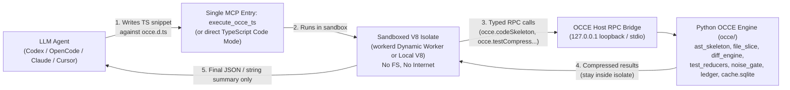

# OCCE v3 Design Doc: TypeScript Code-Mode Architecture (Replacing Multi-Turn MCP Loops)

> **Status:** Architectural Design Proposal (v3)  
> **Project:** OpenCode Context Optimizer (`opencode-context-mcp` / OCCE)  
> **Empirical Baseline:** [`CODEX_FIELD_AUDIT.md`](CODEX_FIELD_AUDIT.md) & [`RESEARCH.md`](RESEARCH.md)  
> **Architectural Inspiration:** Cloudflare Code Mode (`@cloudflare/codemode` + Dynamic Worker Isolates)

---

## 1. Executive Summary & Architectural Turn

OCCE v1/v2 proved that compressing individual tool outputs (`code_skeleton`, `symbol_slice`, `file_slice`, `smart_exec`, `test_compress`, `diff_compact`, `token_ledger`) cuts raw payload size by **75%–90%**. However, our empirical audit of **20 Codex multi-agent sessions (89.38 MB, 4,216 tool calls)** in [`CODEX_FIELD_AUDIT.md`](CODEX_FIELD_AUDIT.md) revealed a deeper structural bottleneck that per-tool compression alone cannot eliminate:

- **Sequential Turn Multiplication:** Even compressed MCP tools still force an **LLM $\to$ JSON-RPC tool call $\to$ wait $\to$ LLM** round-trip for *every single step*. Across Codex's 20 rollouts, the agent spent **4,216 tool calls** (`3,607` `exec` + `420` `wait`/agent polls), pushing **99.2% of all 2,990 measured turns** into the **RED Attention Zone (`>40K` tokens)** and **73.8%** above **100K tokens** (peak: `244,950` tokens).
- **Intermediate Data Leakage:** When an agent inspects 5 files to find 2 methods, checks `git status`, runs `ruff` + `pytest`, and reads a section of `SPEC.md`, every intermediate result enters the LLM's rolling context window and is re-billed on every subsequent turn.

**The Architectural Turn (OCCE v3 — Code Mode):**  
Following Cloudflare's **Code Mode** pattern (`@cloudflare/codemode`), OCCE v3 shifts from *N* discrete MCP tool calls to a **typed TypeScript API (`occe.*`) executed inside a sandboxed V8 isolate**. Instead of issuing 10 sequential tool calls, the agent writes **one short TypeScript async script** that composes `occe` operations (`Promise.all`, loops, filtering, early exits) inside the isolate and returns **only the final distilled result** to the LLM context.

---

## 2. Paradigm Comparison: Standard MCP vs. OCCE v1/v2 vs. OCCE v3 (Code Mode)

| Dimension | Standard Tools / Raw MCP | OCCE v1/v2 (7 MCP Tools) | OCCE v3 (TypeScript Code Mode) |
| :--- | :--- | :--- | :--- |
| **Exposed Tool Schemas** | 10–100+ raw tool definitions | 7 specialized MCP tools | **1 execution tool** (`execute_occe_ts`) + compact `occe.d.ts` (~800 tokens) |
| **Multi-Step Workflow** | N sequential LLM round-trips | N sequential LLM round-trips | **1 round-trip** (`Promise.all` / loops inside isolate) |
| **Intermediate Data** | Full payloads enter LLM context | Compressed payloads enter LLM context | **Zero intermediate leakage** (filtered in V8 memory) |
| **Branching & Retries** | LLM must re-prompt on each branch | LLM must re-prompt on each branch | Native TypeScript `if/else`, `try/catch`, `.filter()` |
| **Codex 6-Step Audit Cost** | ~51,100 tokens | ~6,800 tokens (86.7% saved) | **~1,800–2,400 tokens (~95%+ saved, 1–2 turns)** |

---

## 3. Target System Architecture

OCCE v3 uses a **Dual-Runtime Split**: the LLM-generated TypeScript runs inside a locked-down V8 sandbox, while all workspace access, AST parsing, git diffing, and test compression stay in the trusted Python `occe` host engine.



### 3.1 Layer 1: Sandboxed TypeScript Execution Runtime

- **Cloudflare `workerd` / `DynamicWorkerExecutor` (Primary Production Target):**
  - Spawns an ephemeral V8 isolate per `execute_occe_ts` invocation in milliseconds (no Docker container startup overhead).
  - Configured with `globalOutbound: null` (arbitrary internet `fetch` blocked) and zero filesystem bindings.
  - The only capability injected into the isolate's environment (`env.OCCE`) is a **Service Binding / RPC stub** forwarding `occe.*` calls to the Host RPC Bridge.
- **Local Zero-Cloud Fallback (Windows / Linux / Offline Dev):**
  - For local CLI usage (`codex`, `opencode`) without a Cloudflare account, a lightweight local runner (Deno with `--allow-net=127.0.0.1:<port>` and all `--allow-read`/`--allow-write`/`--allow-run` flags **disabled**, or local `workerd`) executes the exact same `occe.ts` client against the loopback RPC bridge.
  - Same `occe.d.ts` contract, same security boundary: the generated TypeScript can **never** read `.env` files, call external URLs, or spawn arbitrary shells directly.

### 3.2 Layer 2: Host RPC Bridge & Existing Python Engine (`occe/`)

- Exposes the existing `MCPServer.execute_tool` handlers (`occe/server.py`) over a local authenticated RPC endpoint (`POST /rpc` with a per-session bearer nonce).
- Preserves 100% of existing OCCE guarantees:
  - Workspace path confinement (`_resolve_path` anchored to `workspace_root`).
  - Native Windows PowerShell / Unix bash execution in `noise_gate.py`.
  - Shared `.occe/cache.sqlite` skeleton/tombstone store (so coordinator + subagent isolates share cached AST skeletons and token ledgers).
  - Backward compatibility: `python -m occe.server` continues to serve the 7 standalone MCP tools for clients that do not support Code Mode.

---

## 4. Typed TypeScript API Specification (`occe.d.ts`)

Mapped 1-to-1 from the verified schemas in [`occe/protocol.py`](occe/protocol.py), plus the v2/v3 primitives motivated by the Codex audit (`sessionHandoff`, `exclude_generated` on `diffCompact`):

```typescript
/**
 * OCCE v3 Typed Sandbox API (`occe.d.ts`)
 * Exposed inside the Code-Mode isolate as `occe`.
 * Intermediate outputs stay in isolate memory; only `return` values reach the LLM.
 */
declare namespace occe {
  export interface SkeletonOptions {
    path: string;
    /** Maximum AST nesting depth (default: 3). */
    depth?: number;
  }

  export interface SymbolSliceOptions {
    path: string;
    /** Class, method, or function name (e.g. "MCPServer.execute_tool"). */
    symbol: string;
  }

  export interface FileSliceOptions {
    path: string;
    /** 1-based start line (default: 1). */
    start_line?: number;
    /** 1-based end line (optional). */
    end_line?: number;
    /** Maximum lines to return (default: 60). */
    max_lines?: number;
  }

  export interface SmartExecOptions {
    command: string;
    /** Max output lines before head/tail truncation (default: 60). */
    max_lines?: number;
  }

  export interface TestCompressOptions {
    command: string;
  }

  export interface DiffCompactOptions {
    filepath?: string;
    staged?: boolean;
    /** Summarize lockfiles & generated specs like docs/openapi.yaml (default: true). */
    exclude_generated?: boolean;
  }

  export interface ToolResult {
    text: string;
    isError: boolean;
  }

  export interface HandoffSummary {
    branch: string;
    headSha: string;
    status: string;
    recentCommits: string[];
    compactDiff: string;
    ledger: string;
  }

  /** AST outline with [Lstart-end] anchors (80-94% smaller than full reads). */
  function codeSkeleton(opts: SkeletonOptions): Promise<ToolResult>;

  /** Exact implementation of one class/function/method. */
  function symbolSlice(opts: SymbolSliceOptions): Promise<ToolResult>;

  /** Bounded line window for Markdown, YAML, JSON, or configs. */
  function fileSlice(opts: FileSliceOptions): Promise<ToolResult>;

  /** 4-stage noise-gated shell execution (PowerShell on Windows, bash on Unix). */
  function smartExec(opts: SmartExecOptions): Promise<ToolResult>;

  /** Multi-framework test/lint reducer (pytest, vitest, cargo, go, ruff, mypy). */
  function testCompress(opts: TestCompressOptions): Promise<ToolResult>;

  /** Zero-context (-U0) git diff without index/mode boilerplate. */
  function diffCompact(opts?: DiffCompactOptions): Promise<ToolResult>;

  /** Current session token burn, savings, and GREEN/YELLOW/RED Attention Zone. */
  function tokenLedger(): Promise<ToolResult>;

  /** Single-call deterministic git + ledger snapshot for quota/agent handoffs. */
  function sessionHandoff(): Promise<HandoffSummary>;
}
```

### 4.1 Single-Tool MCP Exposure (`codeMcpServer` Pattern)

For MCP clients (Codex CLI, OpenCode CLI, Claude Code, Cursor), OCCE v3 can run in `--mode=codemode`, advertising **one tool** (`execute_occe_ts`) whose description embeds `occe.d.ts` (~800 tokens total):

- `inputSchema`: `{ code: string, timeout_ms?: number }`
- The host wraps `code` in an async harness `async function run(occe) { <user code> }`, executes it in the isolate, captures the JSON-serializable return value (plus `console.log` buffer capped at 4 KB), and returns it as a single MCP tool response.

---

## 5. End-to-End Scenarios (Codex Audit Pain Points Solved)

### Scenario A: Pre-PR Verification Gate (12 Sequential Calls $\to$ 1 Turn)

In the Codex logs, pre-push verification repeatedly took **6–12 turns** (`pytest`, `ruff check`, `ruff format --check`, `markdownlint`, `git status`, `git diff --stat`), re-transmitting a `100K+` token context on every step. With OCCE Code Mode, the agent runs **one** TypeScript snippet:

```typescript
const [tests, lint, fmt, diff] = await Promise.all([
  occe.testCompress({ command: "uv run pytest tests/unit/test_openapi.py -q" }),
  occe.smartExec({ command: "uv run ruff check .", max_lines: 30 }),
  occe.smartExec({ command: "uv run ruff format --check .", max_lines: 20 }),
  occe.diffCompact({ staged: false, exclude_generated: true }),
]);

return {
  testsPassed: !tests.isError,
  testsSummary: tests.text,
  lintClean: !lint.isError && !fmt.isError,
  lintErrors: lint.isError ? lint.text : null,
  diffPreview: diff.text.slice(0, 1500),
};
```

- **Result:** 4 operations executed concurrently; intermediate passing output never enters the prompt; the LLM receives a `< 400`-token structured JSON verdict in **1 turn**.

### Scenario B: Subagent Cold-Start Audit (`15.69M` Tokens $\to$ `< 5K` Tokens)

Instead of a spawned subagent burning dozens of `Get-Content` turns across `app/api/users.py`, `app/auth/provisioning.py`, and `SPEC.md`:

```typescript
const files = ["backend/app/api/users.py", "backend/app/auth/provisioning.py"];
const skeletons = await Promise.all(
  files.map((path) => occe.codeSkeleton({ path, depth: 2 }))
);
const target = await occe.symbolSlice({
  path: "backend/app/auth/provisioning.py",
  symbol: "list_users",
});
const spec = await occe.fileSlice({ path: "SPEC.md", start_line: 35, end_line: 42 });

return { skeletons: skeletons.map((s) => s.text), target: target.text, spec: spec.text };
```

---

## 6. Security, Safety & Failure Boundaries

1. **Network Isolation:** Isolate runs with outbound internet disabled (`globalOutbound: null` in `workerd`; `--allow-net=127.0.0.1:<port>` in local fallback). Model-written code cannot exfiltrate source files or secrets.
2. **Filesystem Isolation:** The isolate has **no** direct filesystem handle. Every file read passes through `occe.codeSkeleton` / `symbolSlice` / `fileSlice` on the Python host, which enforces `workspace_root` confinement.
3. **Secret Protection:** `.env` files, `SESSION_SECRET`, and DB URLs stay outside the isolate. `smartExec` preserves OCCE's noise gate and truncation caps.
4. **Resource & Timeout Caps:** Each isolate invocation enforces a wall-clock timeout (default `30,000 ms`, configurable up to `120,000 ms` for integration test suites) and a capped return payload (`16,000` chars) so a buggy `console.log` loop inside TypeScript cannot re-introduce the `42K`-char truncation bloat observed in Codex.
5. **Typed Error Propagation:** If any RPC call fails (`isError: true`) or the script throws, the isolate returns `{ ok: false, error, partialLogs }` cleanly without crashing the host MCP server.

---

## 7. Projected Impact on the Audited Codex Corpus

Mapping OCCE v3 Code Mode onto the `4,216` tool calls recorded in [`CODEX_FIELD_AUDIT.md`](CODEX_FIELD_AUDIT.md):

| Metric | Raw Codex Baseline | OCCE v1/v2 (7 MCP Tools) | OCCE v3 (TypeScript Code Mode) |
| :--- | ---: | ---: | ---: |
| **Tool Round-Trips** | `4,216` calls | `~3,100` calls | **~500–750 compound executions (~82%–88% fewer turns)** |
| **Direct Tool Payload** | `~4.10M` uncached tok | `~0.82M` uncached tok | **~0.35M–0.50M uncached tok (~88%–91% saved)** |
| **Turns in RED Zone (`>40K`)** | **99.2%** (`2,967/2,990`) | ~30%–45% | **< 10% (majority stays in GREEN `<25K`)** |
| **Polling (`wait`) Turns** | `420` polling calls | `~420` polling calls | **~0** (`Promise.all` / `await` inside isolate) |

---

## 8. Phased Implementation Plan & Proposed Layout

All new Code-Mode components live alongside the existing Python package without breaking `python -m occe.server` or the 70 existing tests:

```text
opencode-context-mcp/
├── occe/
│   ├── server.py               # Existing 7-tool stdio MCP server (unchanged default)
│   ├── rpc_bridge.py           # [Phase 1] Local JSON-RPC/HTTP bridge + session nonce
│   ├── codemode_server.py      # [Phase 2] Single-tool MCP wrapper (`execute_occe_ts`)
│   └── parsers/ & state/       # Existing parsers + v2 cache.sqlite & diff/test upgrades
├── ts-sdk/
│   ├── occe.d.ts               # [Phase 1] Public TypeScript API declarations
│   └── runtime.ts              # [Phase 1] Sandbox `occe` RPC client + return harness
├── workers/
│   └── occe-isolate/           # [Phase 2] Cloudflare Dynamic Worker / workerd runner
└── tests/
    ├── test_rpc_bridge.py      # [Phase 1] Auth nonce, path confinement, tool dispatch
    └── test_codemode_e2e.py    # [Phase 2] Multi-call TS script + timeout/payload caps
```

### Delivery Phases

1. **Phase 1 — Host RPC Bridge & Local V8 Sandbox:** Implement `occe/rpc_bridge.py`, `ts-sdk/occe.d.ts`, `ts-sdk/runtime.ts`, and local sandboxed runner (`execute_occe_ts`) with full path-confinement and payload-cap tests.
2. **Phase 2 — Single-Tool MCP Wrapper (`--mode=codemode`) & `workerd` Adapter:** Wire `occe/codemode_server.py` so Codex CLI (`~/.codex/config.toml`) and OpenCode CLI can switch to Code Mode with one config flag, plus optional Cloudflare Dynamic Worker executor.
3. **Phase 3 — Swarm Cache & `sessionHandoff`:** Connect `.occe/cache.sqlite` and `sessionHandoff()` so coordinator + subagents share skeletons and recover cleanly before quota cliffs.
