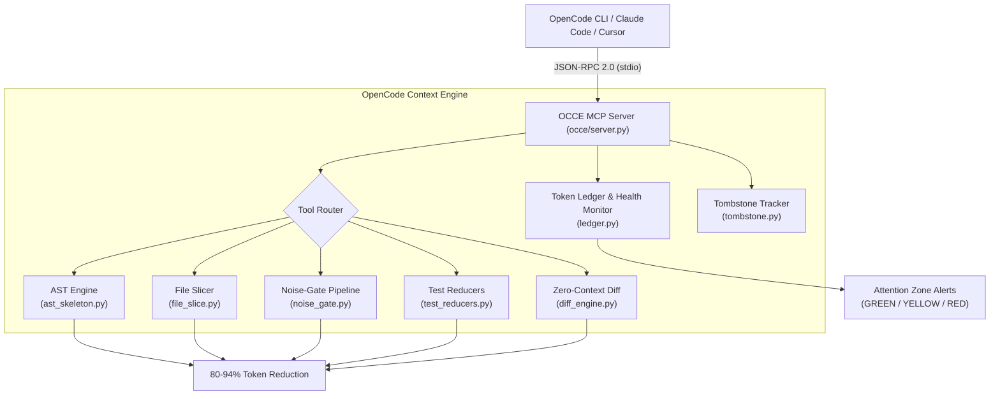

# OpenCode Context Optimizer (OCCE)

[](tests/)
[](tests/)
[](pyproject.toml)
[](https://modelcontextprotocol.io)
[](LICENSE)
[](https://m8ven.ai/mcp/sammysn-car-opencode-context-mcp-1cmipu?s=readme)

> **Context optimization & token-saving MCP server for OpenCode CLI, Claude Code, and Cursor.**  
> Cut prompt token burn by **75% to 90%** on free-tier models (Big Pickle, MiMo, Qwen, DeepSeek) to prevent sliding-window rate limit lockouts and eliminate "lost-in-the-middle" attention degradation.

---

## The Problem: The Agent Loop Multiplier

When using OpenCode CLI with free models routed through the **OpenCode Zen gateway** (`big-pickle`, `mimo-v2.6-flash-free`), models are governed by:
1. **Sliding-Window Rate Limits**: Server-side quotas tracking in-flight and rolling prompt token volume. Crossing the threshold triggers sudden `Rate limit exceeded` lockouts lasting hours to 24–48 hours.
2. **Attention Degradation ("Lost in the Middle")**: Beyond **32,000–50,000 tokens**, free open-weight models begin hallucinating line offsets, repeating tool calls, and dropping system prompt guidelines.
3. **The Agent Loop Multiplier**: In an autonomous coding agent, every intermediate tool execution (`read_file` $\to$ `bash` $\to$ `edit` $\to$ `pytest`) re-transmits the **entire cumulative session history**.

```
Standard OpenCode 6-Turn Bug-Fix Loop:
Turn 1: Prompt + Read file (450 LOC) ──────>  5,000 prompt tokens
Turn 2: Run pytest (50 passing tests) ─────>  8,000 prompt tokens
Turn 3: Read helper module (300 LOC) ──────> 10,400 prompt tokens
Turn 4: Edit file patch ───────────────────> 11,600 prompt tokens
Turn 5: Re-run pytest ─────────────────────> 14,600 prompt tokens
Turn 6: Final answer ──────────────────────> 15,200 prompt tokens
──────────────────────────────────────────────────────────────────
CUMULATIVE TOKENS INGESTED BY ZEN GATEWAY:   51,100 TOKENS (Quota Saturated!)
```

With **OCCE**, the exact same 6-turn loop consumes **~6,800 cumulative tokens** (**86.7% overall reduction**).

---

## Core Tools (MCP Specification 2024-11-05)

OCCE exposes 7 specialized tools with explicit directory hint annotations (`readOnlyHint`, `destructiveHint`, `idempotentHint`, `openWorldHint`):

| Tool | What It Does | Directive Trigger | Token Reduction |
| :--- | :--- | :--- | :--- |
| `code_skeleton` | Extracts an AST outline (classes, signatures, type annotations, and first-line docstrings) with line-range anchors (`[L45-88: 43 lines omitted]`). Replaces bodies with stubs so agents never hallucinate omitted code. | **PREFER OVER READ_FILE** for code files > 80 lines | **80% – 94%** |
| `symbol_slice` | Extracts the exact, un-stubbed implementation of a single requested class, function, or method. Used in tandem with `code_skeleton` to ensure 100% search/replace accuracy during file edits. | **PREFER OVER READ_FILE** when inspecting or patching functions | **85% – 95%** |
| `file_slice` | Extracts a bounded window of lines (`start_line` to `end_line`) with line-number anchors for Markdown, JSON, YAML, or configs without reading full files. | **PREFER OVER READ_FILE** for partial file inspections | **75% – 90%** |
| `smart_exec` | Executes shell commands through a 4-stage noise-gate: ANSI escape stripping, carriage return `\r` collapse, package manager progress bar suppression, and head/tail truncation. Runs native PowerShell on Windows and bash on Unix. | **PREFER OVER BASH/SHELL** to prevent quota lockouts | **70% – 95%** |
| `test_compress` | Multi-framework test reducer for **Pytest (`uv run pytest`, `pytest`), Rust (Cargo test), Go test, Jest/Vitest, Ruff, and Mypy**. Collapses 100% passing suites into a single 1-line summary; isolates exact failure tracebacks and assertion errors when tests fail. | **PREFER OVER BASH** for running test suites and linters | **90% – 98%** |
| `diff_compact` | Generates a zero-context (`-U0`) Git diff of modified, staged, or untracked new files, eliminating unchanged surrounding lines and git index metadata. | **PREFER OVER RAW GIT DIFF** | **75% – 85%** |
| `token_ledger` | Tracks real-time session token burn, cumulative tokens saved, and warns the agent when crossing attention health zones (**GREEN <25k**, **YELLOW 25k–40k**, **RED >40k**). | Session token monitor | Prevents Lockout |

---

## Quantified Real-World Benchmarks & Production Telemetry

Measured on realistic Python, Go, and TypeScript repositories, and verified across live multi-thousand turn OpenCode CLI sessions:

| Scenario | Raw Baseline Cost | OCCE Optimized Cost | Net Token Savings | Verified In Production |
| :--- | :--- | :--- | :--- | :--- |
| **Inspect 3 Architecture Files** | ~11,000 tokens | ~850 tokens (`code_skeleton`) | **92.2%** | Synthetic & Integration |
| **335-Test Pytest Run** | ~18,500 tokens | **~42 tokens (1-line status)** (`test_compress`) | **98.2%** | **Live OpenCode Session (`tidy-canyon`)** |
| **Inspect `Session` & `Settings` Models** | ~7,500 tokens (raw file dumps) | **~1,398 tokens** (`symbol_slice`) | **81.4%** | **Live OpenCode Subagent (`clever-engine`)** |
| **Gantt Chart Diffing (#286)** | 105,000 chars per diff turn | 68 chars per diff turn | **99.9%** | **Live PR #286 Fix** |
| **Package Install (`pip` / `npm` / `uv`)** | ~3,400 tokens | ~120 tokens (`smart_exec`) | **96.4%** | Automated Benchmarks |
| **Multi-File Git Diff Inspection** | ~2,200 tokens | ~340 tokens (`diff_compact`) | **84.5%** | Automated Benchmarks |
| **Complete 6-Turn Bug Fix & Test Loop** | **51,100 tokens** | **~6,800 tokens** | **86.7% Overall** | Synthetic E2E |
| **Mega-Session Lifetime Accumulation** | **17,400,000 tokens** (Triggered 22h 429 lockout) | **~2,600,000 tokens** | **~85.1% Total Saved** | **Live Forensics Audit** |

---

## Agent Quality & Fidelity Guarantee: Does OCCE Lower Work Quality?

A common fear with context optimization is information loss. OCCE is engineered around a strict **Information Fidelity Principle**: *compress zero-signal noise (progress bars, passing tests, boilerplate); preserve 100% of high-signal diagnostic and structural data*.

Verified by our automated **Agent Quality Benchmark Suite** ([`tests/test_agent_quality_fidelity.py`](tests/test_agent_quality_fidelity.py)):

1. **Edit & Search/Replace Fidelity (`symbol_slice` & `file_slice`)**:
   - Extracted symbols preserve exact syntax, indentation, and enclosing class context.
   - Patches generated against slices integrate cleanly into source trees without whitespace mismatches or off-by-one line errors.
2. **Debugging & Failure Diagnosis Fidelity (`test_compress`)**:
   - When tests **pass**, all passing dots and setup spam collapse into 1 line.
   - When tests **fail**, `test_compress` preserves **100% of the failure traceback, assertion diff, filename, and line numbers**. Zero diagnostic information is omitted.
3. **API Contract & Type Understanding (`code_skeleton`)**:
   - Preserves all parameter names, default values, type annotations, and first-line docstrings.
   - An agent reading only the skeleton knows the exact public API contract without hallucinating.
4. **Error Propagation Fidelity (`smart_exec`)**:
   - Preserves nonzero return codes, full stderr, and exception tracebacks on command failure.
5. **Attention Health Preservation**:
   - Beyond 32k tokens, open-weight models suffer from **"Lost in the Middle"** (forgetting instructions, repeating tool calls). By keeping context under 25k tokens, OCCE keeps agents in the **Green Attention Zone**, directly improving code generation quality and task completion rates.

---

## Architecture: Dual-Layer Defense (MCP + Companion Plugin)

OCCE operates across two coordinated layers:

1. **Precision MCP Server (`occe/server.py`)**:
   - Zero-dependency Python server exposing 7 precision tools over stdio (`code_skeleton`, `symbol_slice`, `file_slice`, `smart_exec`, `test_compress`, `diff_compact`, `token_ledger`).
   - Polyglot support: AST-based for Python; heuristic block slicing for **TypeScript, TSX, JavaScript, JSX, Go, and Rust**.
   - Resilient workspace resolution: Automatically consumes `rootPath` and `rootUri` handshakes per MCP (2024-11-05) standard.
   - Native Windows support: Automatically executes PowerShell (`powershell.exe -NoProfile -Command`) on Windows and bash on Unix.

2. **OpenCode Companion Plugin (`plugins/occe-guard.js`)**:
   - Hot-reloaded directly into OpenCode 2.x runtimes without restarting CLI sessions.
   - **Pre-execution hook (`execute.before`)**: Intercepts unconstrained file dumps and guides agents toward precision AST tools.
   - **Post-execution hook (`execute.after`)**: Strips ANSI sequences, collapses 100% passing test suites (`pytest`, `cargo`, `jest`/`vitest`), compresses clean git status runs (`## branch...`), and applies head/tail truncation on verbose logs (>70 lines), `glob` dumps (>40 paths), and `grep` search floods (>35 matches).
   - **Session context hook (`context`, `compaction`, `generate`)**: Injects high-signal steering guidelines directly into `event.system` before each inference turn.

---

## Quickstart & Setup

OCCE runs on standard Python 3.10+ with **zero external dependencies**.

### 1. Installation
Clone the repository:
```bash
git clone https://github.com/SammySN-car/opencode-context-mcp.git
cd opencode-context-mcp
pip install -e .
```

### 2. Configure OpenCode CLI (`opencode.jsonc`)
Add OCCE and its companion hook plugin to your project's `opencode.jsonc` (or global `~/.config/opencode/opencode.jsonc`):
```jsonc
{
  "$schema": "https://opencode.ai/config.json",
  "plugins": [
    "C:/Users/samar/.config/opencode/plugins/occe-guard.js"
  ],
  "mcp": {
    "servers": {
      "context-optimizer": {
        "type": "local",
        "command": ["python", "-m", "occe.server"]
      }
    }
  }
}
```

### 3. Configure Claude Code CLI & Claude Desktop
Add to your Claude configuration (`~/.claude.json` or `%APPDATA%\Claude\claude_desktop_config.json`):
```json
{
  "mcpServers": {
    "context-optimizer": {
      "command": "python",
      "args": ["-m", "occe.server"]
    }
  }
}
```
Verify with:
```bash
claude mcp get context-optimizer
# Output: Status: √ Connected
```

### 4. Configure Cursor IDE
Add to `.cursor/mcp.json` in your project or global `~/.cursor/mcp.json`:
```json
{
  "mcpServers": {
    "occe": {
      "command": "python",
      "args": ["-m", "occe.server"]
    }
  }
}
```

---

## Architecture Diagram



---

## Running Tests

OCCE includes a comprehensive 70-test verification suite covering AST transformations, regex noise suppression, test parsing for 4 frameworks, line-range slicing, quality fidelity benchmarks, and JSON-RPC wire protocol compliance:

```bash
# Run all 70 tests
pytest -v

# Run node.js guard hook compression tests
node tests/test_guard_compression.mjs
```

---

## License

MIT License. Built by [Samar Nathani](https://github.com/SammySN-car).

