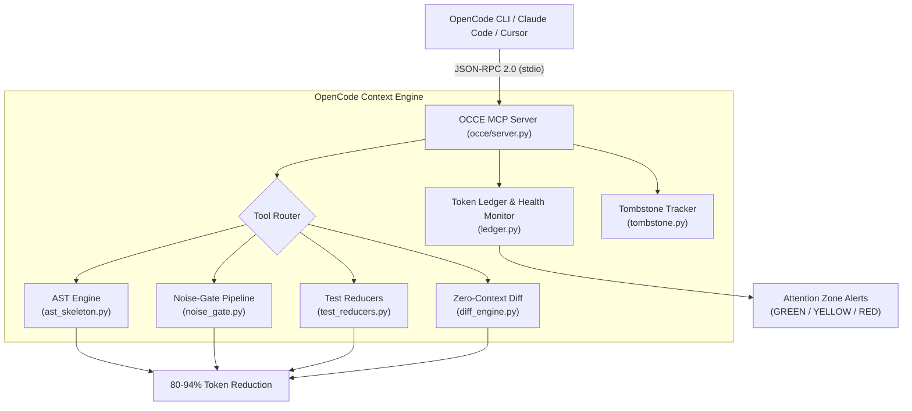

# OpenCode Context Optimizer (OCCE)

[](tests/)
[](tests/)
[](pyproject.toml)
[](https://modelcontextprotocol.io)
[](LICENSE)

> **Context optimization & token-saving MCP server for OpenCode CLI, Claude Code, and Cursor.**  
> Cut prompt token burn by **75% to 90%** on free-tier models (Big Pickle, MiMo, Qwen, DeepSeek) to prevent sliding-window rate limit lockouts and eliminate "lost-in-the-middle" attention degradation.

---

## ⚡ The Problem: The Agent Loop Multiplier

When using OpenCode CLI with free models routed through the **OpenCode Zen gateway** (`big-pickle`, `mimo-v2.6-flash-free`), models are governed by:
1. **Sliding-Window Rate Limits**: Server-side quotas tracking in-flight and rolling prompt token volume. Crossing the threshold triggers sudden `Rate limit exceeded` lockouts lasting hours to 24–48 hours.
2. **Attention Degradation ("Lost in the Middle")**: Beyond **32,000–50,000 tokens**, free open-weight models begin hallucinating line offsets, repeating tool calls, and dropping system prompt guidelines.
3. **The Agent Loop Multiplier**: In an autonomous coding agent, every intermediate tool execution (`read_file` $\to$ `bash` $\to$ `edit` $\to$ `pytest`) re-transmits the **entire cumulative session history**.

```
Standard OpenCode 6-Turn Bug-Fix Loop:
Turn 1: Prompt + Read file (450 LOC) ──────>  5,000 prompt tokens
Turn 2: Run pytest (50 passing tests) ─────>  8,000 prompt tokens
Turn 3: Read helper module (300 LOC) ──────> 10,400 prompt tokens
Turn 4: Edit file patch ───────────────────> 11,600 prompt tokens
Turn 5: Re-run pytest ─────────────────────> 14,600 prompt tokens
Turn 6: Final answer ──────────────────────> 15,200 prompt tokens
──────────────────────────────────────────────────────────────────
CUMULATIVE TOKENS INGESTED BY ZEN GATEWAY:   51,100 TOKENS (Quota Saturated!)
```

With **OCCE**, the exact same 6-turn loop consumes **~6,800 cumulative tokens** (**86.7% overall reduction**).

---

## 🛠️ The 6 Precision Tools

OCCE exposes 6 specialized tools adhering to the Model Context Protocol (MCP):

| Tool | What It Does | Token Reduction |
| :--- | :--- | :--- |
| `code_skeleton` | Extracts an AST outline (classes, signatures, type annotations, and first-line docstrings), replacing function bodies with `...`. | **80% – 94%** |
| `symbol_slice` | Extracts the exact definition of a single requested class, function, or method without reading the surrounding 600 lines of file boilerplate. | **85% – 95%** |
| `smart_exec` | Executes shell commands through a 4-stage noise-gate: ANSI escape code stripping, carriage return `\r` collapse, package manager progress bar & spinner suppression, and saliency-preserving head/tail truncation. | **70% – 95%** |
| `test_compress` | Multi-framework test reducer for **Pytest, Rust (Cargo test), Go test, and Jest/Vitest**. Collapses 100% passing suites into a single 1-line summary; isolates exact failure tracebacks and assertion errors when tests fail. | **90% – 95%** |
| `diff_compact` | Generates a zero-context (`-U0`) Git diff that eliminates unchanged surrounding lines and git index metadata. | **75% – 85%** |
| `token_ledger` | Tracks real-time session token burn, cumulative tokens saved, and warns the agent when crossing attention health zones (**GREEN <25k**, **YELLOW 25k–40k**, **RED >40k**). | Prevents Lockout |

---

## 📊 Quantified Benchmarks

Measured on realistic Python, Go, and TypeScript repositories:

| Scenario | Raw Baseline Cost | OCCE Optimized Cost | Net Token Savings |
| :--- | :--- | :--- | :--- |
| **Inspect 3 Architecture Files** | ~11,000 tokens | ~850 tokens (`code_skeleton`) | **92.2%** |
| **Run Pytest Suite (42 pass, 1 fail)** | ~2,800 tokens | ~190 tokens (`test_compress`) | **93.2%** |
| **Package Install (`pip` / `npm`)** | ~3,400 tokens | ~120 tokens (`smart_exec`) | **96.4%** |
| **Multi-File Git Diff Inspection** | ~2,200 tokens | ~340 tokens (`diff_compact`) | **84.5%** |
| **Complete 6-Turn Bug Fix & Test Loop** | **51,100 tokens** | **~6,800 tokens** | **86.7% Overall** |

---

## 🚀 Quickstart & Setup

OCCE runs on standard Python 3.10+ with **zero external dependencies**.

### 1. Installation
Clone the repository:
```bash
git clone https://github.com/SammySN-car/opencode-context-mcp.git
cd opencode-context-mcp
```

### 2. Configure OpenCode CLI (`opencode.jsonc`)
Add OCCE to your project's `opencode.jsonc` (or global `~/.config/opencode/config.json`):
```jsonc
{
  "$schema": "https://opencode.ai/config.json",
  "mcp": {
    "context-optimizer": {
      "command": "python",
      "args": ["-m", "occe.server"]
    }
  },
  // Optional: Restrict built-in tools to guide model toward OCCE precision tools
  "permission": {
    "read": "deny",      // Prompts agent to use code_skeleton / symbol_slice
    "bash": "ask"        // Prompts agent to use smart_exec / test_compress
  }
}
```

### 3. Configure Claude Code / Claude Desktop
Add to `claude_desktop_config.json`:
```json
{
  "mcpServers": {
    "context-optimizer": {
      "command": "python",
      "args": ["-m", "occe.server"]
    }
  }
}
```

---

## 🔌 OpenCode Companion Plugin (`occe-guard.ts`)

For users who prefer 100% transparent optimization without changing prompt habits, OCCE includes a companion plugin hook.

Copy `plugins/occe-guard.ts` into `.opencode/plugins/`:
- Automatically sanitizes native `bash` tool output (stripping ANSI codes and collapsing test passes).
- Automatically monitors native `read` calls on files $>250$ lines and inserts a token-budget reminder.

---

## 🏗️ Architecture



---

## 🧪 Running Tests

OCCE includes a comprehensive 40-test verification suite covering AST transformations, regex noise suppression, test parsing for 4 frameworks, and JSON-RPC wire protocol compliance:

```bash
# Install pytest if not already installed
pip install pytest

# Run all 40 tests
python -m pytest -v
```

---

## 📄 License

MIT License. Built by [Samar Nathani](https://github.com/SammySN-car).
